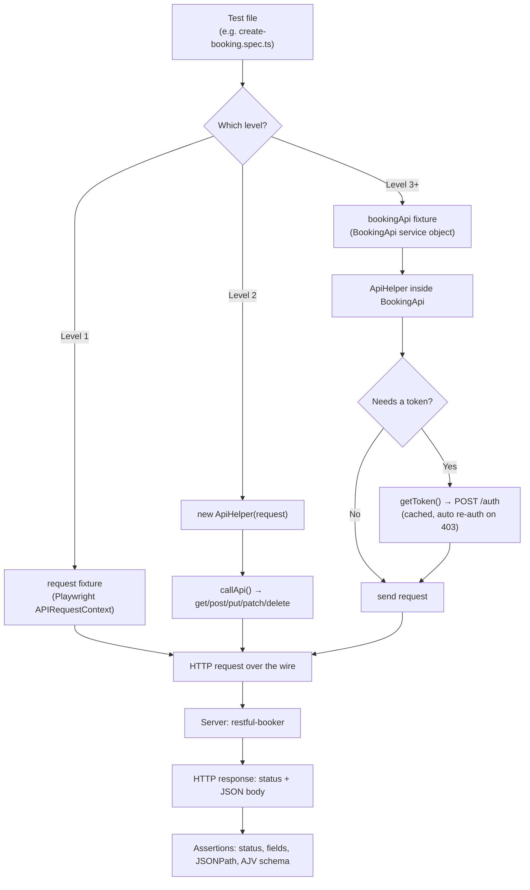
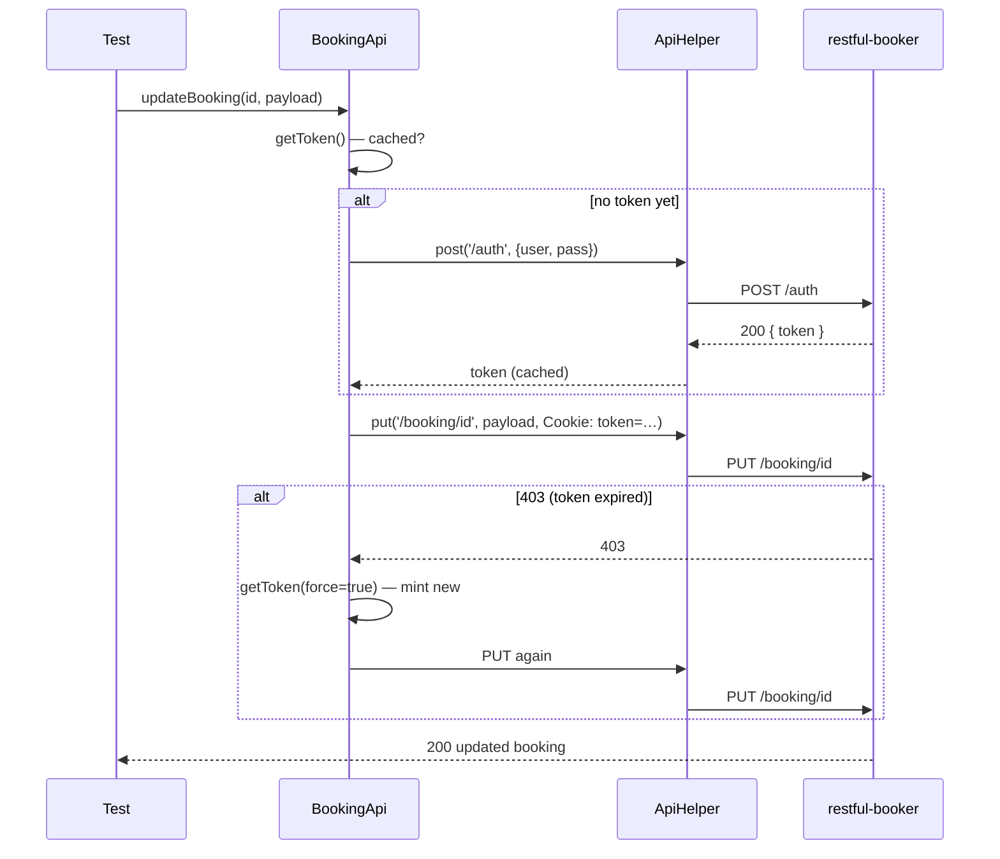
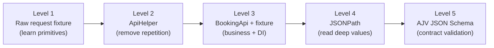

# The Complete API Testing Framework — Explained Like You're 5

> A plain-English tour of **how this repo tests APIs**: what every file does, how a request travels from a test to the server and back, and the concepts underneath. Ends with interview questions & answers.
>
> Target API in this repo: **restful-booker** (`https://restful-booker.herokuapp.com`) plus a small demo against `gorest.in`.

---

## 1. What is API testing? (the 5-year-old version)

Think of a restaurant.

- **UI testing** is you sitting at the table, looking at the menu, pointing at a dish. You test what the *customer sees*.
- **API testing** is you walking straight into the kitchen and talking to the chef: *"One booking, please — first name Jim, last name Brown."* You never touch the menu or the table. You test the *kitchen* directly.

The "kitchen" speaks in **requests** and **responses**. You send a message (a request) using a **verb** (GET/POST/PUT/PATCH/DELETE) to a **URL**, sometimes with a **body** (the order details), and the server sends back a **status code** and **JSON**.

That's the whole game. Everything else in this framework is about doing that *cleanly, repeatedly, and at scale*.

---

## 2. The cast of characters (every file, in one line)

| File | What it is | Why it exists |
|------|-----------|---------------|
| `src/tests/apiTests/01_restfulbooker_raw/*` | **Level 1** — raw requests using Playwright's built-in `request` fixture | Learn the primitives: GET, POST, PUT, ping, contexts |
| `src/tests/apiTests/02_restfulbooker_apiHelper/*` | **Level 2** — same calls through `ApiHelper` | Stop repeating headers/URL/JSON parsing |
| `src/tests/apiTests/03_restfulbooker_fixture_e2e/*` | **Level 3** — full CRUD through `BookingApi` handed over by a fixture | Realistic, readable, token-free tests |
| `src/tests/apiTests/04_jsonpathplus/*` | **Level 4** — pluck values out of JSON with JSONPath | Assert on deeply nested fields |
| `src/tests/apiTests/05_ajv_jsonschema_validator/*` | **Level 5** — validate the whole response shape with AJV | Contract / schema validation |
| `src/utils/ApiHelper.ts` | Thin wrapper over HTTP verbs | Generic, reusable request layer |
| `src/api/BookingApi.ts` | The **service object** for bookings | Business-meaningful methods with token handling |
| `src/fixtures/booker.fixture.ts` | Custom `test` with `bookingApi` + `bookerToken` | Dependency injection for APIs |
| `src/testdata/booking.data.ts` | Builds random bookings from `DataGenerator` | Reusable, fresh test data |
| `src/testdata/jsonschema/create-booking.schema.json` | JSON Schema for a create response | Contract definition |
| `src/config/env.ts` | Reads `.env`, `requireEnv`, `envOr`, `assertEnv` | Environment configuration |
| `src/utils/logger.ts` | Winston logger (`logger`, `createLogger(scope)`) | See what happened in each step |
| `playwright.config.ts` | `baseURL` resolver, reporters, projects | Wires everything together |

---

## 3. The big flow: how a request travels



**ELI5:** the test is the customer. It either shouts at the chef directly (Level 1), uses a waiter (ApiHelper, Level 2), or uses a full restaurant manager who also handles the keys and the tab (BookingApi + fixture, Level 3+). The food (response) comes back and the test checks it.

---

## 4. Concept-by-concept

### 4.1 The `request` fixture (the raw tool)

Playwright gives every test a `request` object — an `APIRequestContext`. It can do `.get()`, `.post()`, `.put()`, `.patch()`, `.delete()`.

```ts
test('ping request - GET', async ({ request }) => {
  const response = await request.get('/ping');   // '/ping' resolves against baseURL
  expect(response.status()).toBe(201);
});
```

- `baseURL` comes from `playwright.config.ts` (see §4.8), so `/ping` becomes the full URL.
- The response is an `APIResponse`: `.status()`, `.json()`, `.text()`, `.headers()`.
- **`request.newContext({...})`** creates an *isolated* context with its own base URL and headers — used in `03_newContext_api.spec.ts` to avoid polluting the shared context.

### 4.2 HTTP verbs & CRUD (the vocabulary)

| Verb | CRUD meaning | Example in this repo |
|------|--------------|----------------------|
| **GET** | Read | `GET /booking`, `GET /booking/{id}`, `GET /ping` |
| **POST** | Create | `POST /booking`, `POST /auth` |
| **PUT** | Replace | `PUT /booking/{id}` (full update, needs token) |
| **PATCH** | Partial update | `PATCH /booking/{id}` (only changed fields) |
| **DELETE** | Delete | `DELETE /booking/{id}` (needs token) |

**Idempotency (interview favourite):** GET/PUT/DELETE are *idempotent* (same result if repeated); POST is not (each POST creates a new booking). PATCH may or may not be.

### 4.3 Status codes you will meet here

| Code | Meaning | Where in this repo |
|------|---------|--------------------|
| 200 OK | Success | create/update booking |
| 201 Created | Created | `GET /ping` returns 201; `DELETE /booking/{id}` returns **201**, not 204 |
| 400 Bad Request | Missing/invalid field | PUT without `firstname` |
| 403 Forbidden | Bad/missing token | PUT without token |
| 404 Not Found | Booking gone | `GET /booking/{id}` after delete |
| 405 Method Not Allowed | Non-existent id for PUT | this API returns 405, not 404 |

> **Gotcha to remember:** restful-booker's `/auth` returns **200 with `{reason:"Bad credentials"}`** on bad login, so `BookingApi.auth()` checks the *body* for a token, not just the status. Also DELETE returns **201**, and a bad PUT id returns **405**. Real-world APIs are weird — always assert the actual contract.

### 4.4 `ApiHelper` — the reusable waiter (Level 2)

`src/utils/ApiHelper.ts` wraps the request context so tests don't repeat headers, URL-building, or JSON parsing.

- `ApiContext = Page | APIRequestContext` — it can pull `.request` off a `Page`, so it works in both UI and API tests.
- `callApi(options)` — one generic dispatcher over the verbs.
- Convenience: `get`, `post`, `put`, `delete`, `patch`.
- `buildUrl()` — appends query params (`?firstname=Jim&...`).
- `parseJsonResponse<T>(res)` — typed `res.json()`.
- `isSuccess()` — 2xx check. `isFailureClient()` — 4xx check.
- `callApiWithRetry(opts, { condition, pollingInterval, retryCount })` — retries until a condition passes (great for eventually-consistent APIs).

```ts
const api = new ApiHelper(request);
const res = await api.post('/booking', payload);
expect(api.isSuccess(res)).toBe(true);
const body = await api.parseJsonResponse<CreateBookingResponse>(res);
```

**Why:** when every test builds its own URL/headers, one typo breaks everything. One helper = one place to fix.

### 4.5 `BookingApi` — the service object (Level 3)

`src/api/BookingApi.ts` is the *business layer*. Instead of "send a POST to /booking", you call `bookingApi.createBooking(payload)`.

Under the hood it uses `ApiHelper`. On top it adds:

- **Strong types** — `Booking`, `BookingDates`, `CreateBookingResponse`, `BookingId`.
- **Two flavours of each method**:
  - `createBooking()` → returns parsed `{ bookingid, booking }` and throws on failure.
  - `createBookingResponse()` → returns the **raw** response so a negative test can assert the status (e.g. 500).
- **Managed tokens**: `getToken()` mints once, caches it, and `sendAuthed()` **re-authenticates on a 403 and retries**. Pass an explicit token to keep negative tests honest.
- **`invalidateToken()`** — drop the cache to force a fresh token.

This is the **Service Object pattern**: one class per real-world resource, with typed, intention-revealing methods.

### 4.6 Fixtures — dependency injection (Level 3+)

A **fixture** is a reusable setup block that Playwright runs for you and hands into the test as an argument.

`src/fixtures/booker.fixture.ts` extends the base `test`:

```ts
export const test = base.extend<BookerFixtures>({
  bookingApi: async ({ request }, use) => {
    await use(new BookingApi(request));   // build once, hand over
  },
  bookerToken: async ({ bookingApi }, use) => {
    await use(await bookingApi.getToken()); // token available as a value
  },
});
```

Usage:

```ts
import { test, expect } from '@fixtures/booker.fixture';

test('create a booking', async ({ bookingApi }) => {
  const { bookingid } = await bookingApi.createBooking(payload);
  expect(bookingid).toBeGreaterThan(0);
});
```

**ELI5:** instead of crafting your tools every time you cook, a helper sets the cutting board and knife in front of you the moment you start. Ask for `bookingApi`, receive it ready to use.

**Fixture vs `beforeEach`:** fixtures are lazy (only built when requested), composable (a fixture can depend on another), and scoped per test. `beforeEach` always runs even if unused.

### 4.7 Token flow (auth) — step by step



**Key idea:** tokens live in a fixture/service layer, not scattered through tests. If the token expires mid-run, the service object heals itself.

### 4.8 Environment configuration (`src/config/env.ts`)

- `dotenv.config({ quiet: true })` loads `.env` once (override stays false so CI/shell vars win).
- `requireEnv(key)` — throws if missing (fail fast).
- `envOr(key, fallback)` — optional with default.
- `assertEnv(...keys)` — reports *all* missing keys at once.
- `playwright.config.ts` has `resolveBaseURL()`: `BASE_URL` wins, else `TTA_ENV` (`qa|stg|prod|dev|api`) picks `QA_BASE_URL`, `STG_BASE_URL`, etc. `TTA_ENV=api` targets restful-booker.

```ts
BASE_URL = process.env.BASE_URL
  ?? (TTA_ENV === 'api' ? API_BASE_URL : ...)
```

**Why:** the same tests run against qa/stg/prod by changing **one** environment variable, never code.

### 4.9 Test data (`src/testdata/booking.data.ts`)

- `buildBookingFromGenerator(overrides, stayNights)` — random booking via `DataGenerator` (Faker): names, price 100–1000, boolean, checkout derived from check-in so dates are always in order, check-in relative to today so it never ages.
- `buildBooking(...)` — same, but check-in pinned to `PINNED_CHECKIN` for JSONPath tests that assert a known value.
- `overrides` lets a test pin just the fields it cares about (`{ firstname: 'E2E' }`) while the rest stays random.

**Why:** hand-written fixtures go stale; generators give fresh, valid data every run while staying deterministic-friendly.

### 4.10 JSONPath (Level 4)

`jsonpath-plus` lets you pull a value out of nested JSON without chaining `.` accesses.

```ts
import { JSONPath } from 'jsonpath-plus';
const firstname = JSONPath({ path: '$.booking.firstname', json: response, wrap: false });
```

- `$.booking.bookingdates.checkin` digs into nested objects.
- `$..price` (recursive descent), `$.items[?(@.totalprice > 500)]` (filters) — full JSONPath power.
- `wrap: false` returns the raw value instead of an array.

**ELI5:** instead of walking room by room to find a toy, JSONPath is a treasure map that says "under the bed, third drawer".

### 4.11 JSON Schema validation with AJV (Level 5)

A **JSON Schema** describes the *shape* of valid JSON: which fields are required, their types, ranges, formats.

`src/testdata/jsonschema/create-booking.schema.json` says: required `bookingid` (integer ≥ 1) and `booking` (object with required fields, dates in `date` format, `additionalProperties: false` — no extras allowed).

```ts
import Ajv from 'ajv';
import addFormats from 'ajv-formats';
const ajv = new Ajv({ allErrors: true });
addFormats(ajv);                       // enables "format": "date"
const validate = ajv.compile(schema);

expect(validate(response), ajv.errorsText(validate.errors)).toBe(true);
```

**Why it's powerful:** you validate the *entire contract* in one assertion — types, required fields, no extra fields, formats — instead of checking field by field.

**JSON Schema vs JSONPath:**
- JSONPath **reads** a specific value → assert `== expected`.
- JSON Schema **validates the whole document** → assert "this is a legal response".

### 4.12 Assertions

Playwright's `expect` is the assertion library. Common API patterns:

```ts
expect(res.status()).toBe(200);            // status
expect(body.bookingid).toBeTruthy();       // existence
expect(body.booking).toEqual(payload);     // deep equality
expect(updated).toMatchObject({ totalprice: 950 }); // partial
expect(body.bookingid).toBeGreaterThan(0); // numeric ranges
```

### 4.13 `test.step` — readable reports

```ts
await test.step('Step 1 - Create auth token', async () => { ... });
await test.step('Step 2 - Update booking', async () => { ... });
```

Each step shows in the HTML report with its own duration and status. When a step fails, you instantly see *which* part broke. `test.describe.serial` + shared state (`bookingFlowState`) is used for sequential CRUD where step 2 needs step 1's token/booking id.

### 4.14 Logging (`src/utils/logger.ts`)

- `logger.info(...)` — root logger.
- `createLogger('create-booking')` — child logger so every line is tagged `[create-booking]`.
- Writes to console (colour) **and** `logs/combined.log`. Level via `LOG_LEVEL`.
- In API tests it logs payloads, headers, and responses for debuggability.

### 4.15 Negative testing

`06_put_operation_negative_scenario.spec.ts` proves the API *rejects* bad input:

| Scenario | Expected |
|----------|----------|
| PUT without a token | 403 |
| PUT with an invalid token | 403 |
| PUT a non-existent booking id | 405 |
| PUT missing a required field | 400 |

**Principle:** happy paths prove it works; negative paths prove it *fails correctly* — often where real bugs hide.

### 4.16 Running the API tests

```bash
# all API tests
npx playwright test src/tests/apiTests

# just the target environment
TTA_ENV=api npx playwright test src/tests/apiTests

# one file, headed for debugging
npx playwright test src/tests/apiTests/03_restfulbooker_fixture_e2e/booking-crud.e2e.spec.ts

# filter by tag
npx playwright test --grep @e2e
```

> Note: `package.json` only defines a `flaky` script; tests run through `npx playwright test`.

### 4.17 The five "levels" at a glance



Each level keeps all the previous benefits and adds one. By Level 5 a test is: *get `bookingApi` from a fixture → create → validate contract, plucked fields, and echoed data → done.*

---

## 5. Interview Questions & Answers

### Fundamentals

**Q1. What is API testing and how does it differ from UI testing?**
API testing calls the server directly (requests/responses, JSON, status codes) with no browser. It's faster, more stable, and can hit edge cases the UI hides. UI testing drives a real browser and checks what the user sees. API tests find logic bugs; UI tests find rendering/usability bugs.

**Q2. What are the main HTTP methods and their semantics?**
GET (read), POST (create), PUT (replace/full update), PATCH (partial update), DELETE (remove). GET/PUT/DELETE are idempotent; POST is not.

**Q3. Which status codes matter most?**
2xx success (200 OK, 201 Created, 204 No Content), 4xx client errors (400 Bad Request, 401 Unauthorized, 403 Forbidden, 404 Not Found), 5xx server errors. Assert the exact code the contract specifies.

**Q4. PUT vs PATCH?**
PUT replaces the whole resource — omitted fields are typically cleared/rejected (here, missing `firstname` → 400). PATCH updates only the provided fields.

### Playwright-specific

**Q5. How do you make API calls in Playwright?**
Via the built-in `request` fixture (`APIRequestContext`): `request.get/post/put/patch/delete`. You can also create isolated contexts with `request.newContext({ baseURL, extraHTTPHeaders })`.

**Q6. How does `baseURL` help?**
Set once in config; relative paths like `'/booking'` resolve against it. Switching environments is a config/env change, not a code change.

**Q7. Difference between `Page` and `APIRequestContext`?**
`Page` drives a browser tab; `APIRequestContext` makes HTTP calls with no browser. `ApiHelper` accepts either via `ApiContext = Page | APIRequestContext`, pulling `.request` when given a Page.

**Q8. What is a fixture and why use one for API clients?**
A fixture is setup/teardown injected into tests. It's lazy, composable, and per-test. Using one to hand over a `BookingApi` avoids `new BookingApi(...)` boilerplate and centralises token handling. Fixtures can depend on other fixtures (`bookerToken` depends on `bookingApi`).

**Q9. Fixture vs `beforeEach`?**
Fixtures only run when requested, can be composed, and are scoped; `beforeEach` always runs for every test in the block. Fixtures are the idiomatic Playwright way to share setup.

**Q10. Why does the repo have both `createBooking()` and `createBookingResponse()`?**
The typed method throws on non-2xx and returns parsed data — convenient for happy paths. The raw-response variant exposes the `APIResponse` so negative tests can assert exact status codes (e.g. 500) without the method throwing.

### Design & patterns

**Q11. What is the Service Object pattern?**
One class per API resource (`BookingApi`) with typed, intention-revealing methods (`createBooking`, `updateBooking`) that hide request/headers/parsing. Tests read like business steps instead of HTTP plumbing.

**Q12. How is authentication handled and why is that good?**
`BookingApi.getToken()` mints and caches a token; `sendAuthed()` re-auths once on a 403 and retries. Tokens never leak into tests, expired tokens self-heal, and explicit tokens still allow negative tests.

**Q13. Why check the auth response body, not just status?**
restful-booker returns **200** with `{reason:"Bad credentials"}` for invalid logins. Status alone would falsely pass; the code verifies a `token` exists.

**Q14. How do you keep tests independent while testing a CRUD lifecycle?**
Use `test.describe.serial` and share state (token, booking id) when the flow genuinely requires order, or model each test's setup with fixtures so it's isolated. This repo does both: serial CRUD specs, and fixture-based `bookingApi` for independent tests.

**Q15. How do you produce reusable, valid test data?**
`buildBookingFromGenerator()` uses Faker to generate valid data, derives check-out from check-in, keeps dates relative to today, and lets callers override only the fields under test. `buildBooking()` pins a known date where an assertion needs a literal.

### Validation

**Q16. JSONPath vs JSON Schema — when do you use each?**
JSONPath extracts a specific value for equality checks. JSON Schema validates the whole document's structure/types/formats in one assertion. Use JSONPath for "is this field right?" and AJV for "is this response the right shape?".

**Q17. What is a JSON Schema and what can it enforce?**
A declarative description of JSON: required fields, types, ranges (`minimum`), string formats (`date`), and `additionalProperties: false` to forbid extras. AJV compiles and validates against it.

**Q18. Why `allErrors: true` and `ajv-formats`?**
`allErrors` reports every broken field, not just the first. `ajv-formats` adds standard string formats like `date` that the schema uses.

**Q19. How do negative tests fit in?**
They assert the API rejects bad input correctly: no token → 403, invalid token → 403, missing field → 400, unknown id → 405. They catch validation and auth gaps.

### Reliability & tooling

**Q20. How do you handle flaky/slow APIs?**
`ApiHelper.callApiWithRetry()` retries a request until a `condition` passes, with `pollingInterval` and `retryCount`. Playwright also supports test-level `retries` in config.

**Q21. How do you debug a failing API test?**
Read the `test.step` breakdown, check the scoped logs (`[create-booking]` payload/status/response), and the JSON report (`test-results/results.json`) or the custom TTA HTML report. Since API tests need no browser, the request/response logs are the main evidence.

**Q22. How does the framework switch environments?**
`TTA_ENV` (qa/stg/prod/dev/api) plus per-env `*_BASE_URL` vars, honoured by `resolveBaseURL()`; `BASE_URL` overrides everything. `env.ts` helpers (`requireEnv`, `envOr`, `assertEnv`) fail fast on missing config.

**Q23. What is `additionalProperties: false` good for?**
It turns schema drift into a failure — a new unexpected field in the response breaks the contract test, prompting a deliberate decision instead of silent change.

**Q24. How would you add a new API resource (say, `RoomApi`)?**
Create `src/api/RoomApi.ts` using `ApiHelper`, add a `roomApi` fixture in a `.fixture.ts`, add typed payloads/data builders under `src/testdata`, and write specs at the level appropriate to the test (service object for happy/negative paths, AJV for contracts).

**Q25. Why assert status *and* body?**
Status confirms the class of outcome; the body confirms the actual data. A 200 with wrong data is still a bug.

---

## 6. Quick command cheat-sheet

```bash
npx playwright test src/tests/apiTests                       # all API tests
TTA_ENV=api npx playwright test src/tests/apiTests           # target restful-booker
npx playwright test --grep @P0                               # priority filter
npx playwright test --grep @e2e                              # E2E filter
npx playwright report                                       # open last HTML report
```

---

*Every concept above maps to a real file in this repo: `src/utils/ApiHelper.ts`, `src/api/BookingApi.ts`, `src/fixtures/booker.fixture.ts`, `src/testdata/booking.data.ts`, and the five `src/tests/apiTests` levels.*
