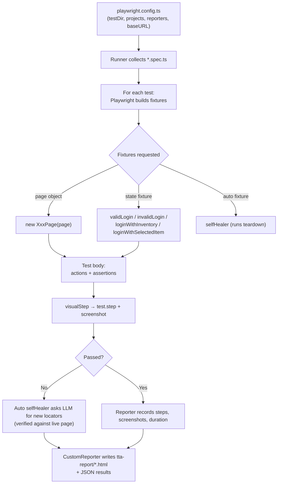
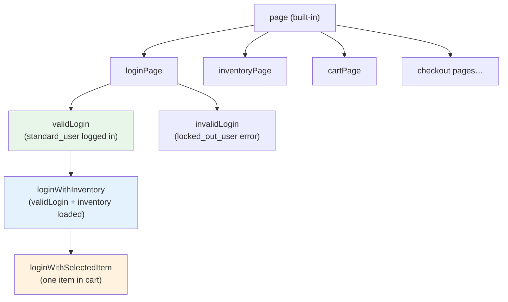
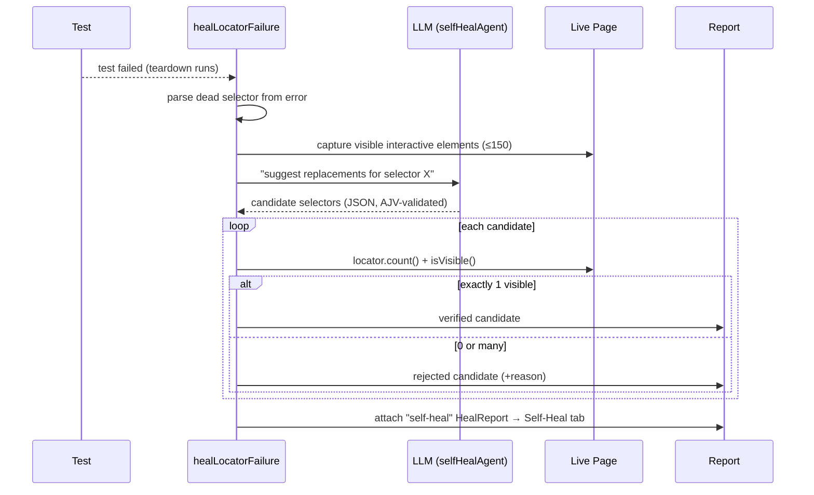

# The Complete UI Testing Framework — Explained Like You're 5

> A plain-English tour of **how this repo tests the web UI**: the Page Object Model, the fixture graph, the shared element helper, data generation, screenshots, self-healing locators, reporting — and interview Q&A at the end.
>
> App under test: the **TTACart** demo storefront (SauceDemo-style), served under `https://app.thetestingacademy.com/playwright/ttacart/`.

---

## 1. What is UI testing? (the 5-year-old version)

Imagine a robot that sits at a computer and uses the website *exactly like a person*: it clicks the login button, types a name, adds a shirt to the cart, and checks that the "Thank you for your order!" screen appears.

- **UI testing = driving a real browser** and checking what the customer actually sees.
- The robot is **Playwright**, which controls Chromium.
- The robot must find things on the page (**locators**), do things (**actions**: click, type), and check things (**assertions**).

The hard part isn't clicking. It's doing it in a way that (a) doesn't break every time the HTML changes, (b) can be reused, and (c) tells you *why* it failed. That's what a **framework** is for.

---

## 2. The cast of characters (every file, in one line)

| File | What it is | Why it exists |
|------|-----------|---------------|
| `playwright.config.ts` | Test runner config | `testDir`, projects (chromium), reporters, base URL, screenshots/video/trace |
| `src/pages/BasePage.ts` | Abstract base class for all pages | Shares `page`, `el`, `log`, `goto()` |
| `src/pages/LoginPage.ts` … `CheckoutCompletePage.ts` | **Page Objects** (one per screen) | Locators + actions + assertions for one page |
| `src/utils/UtilElementLocator.ts` | Reusable element helper (`el`) | click/fill/getText/waits with logging & timeouts |
| `src/fixtures/test-base.ts` | Custom `test` with page-object & state fixtures | Dependency injection for the UI |
| `src/utils/DataGenerator.ts` | Faker-backed data factory | Fresh, valid test data |
| `src/utils/visualSteps.ts` | `test.step` + optional screenshot | Attach a screenshot per step to the report |
| `src/utils/stepScreenshot.ts` | `shot(page, index, name)` | Pin a screenshot to a specific step |
| `src/utils/selfHeal.ts` | `HealReport` types | Shape the Self-Heal tab consumes |
| `src/ai/agents/selfHealAgent.ts` | AI locator repair (auto fixture) | Suggests replacement selectors after a failure |
| `src/utils/CustomReporter.ts` | Custom HTML reporter ("TTA report") | Rich report: steps, screenshots, AI tabs |
| `src/utils/logger.ts` | Winston logging | Scoped log lines per page/action |
| `src/utils/{yaml,csv,excel,db}Reader.ts` | Data-driven test readers | YAML/CSV/Excel/MySQL test data |
| `src/config/{env,credentials}.ts` | Env + credentials | Centralised, `.env`-driven config |
| `src/testdata/logintestdata.json` | Login cases | Feeds the login fixtures |

---

## 3. The big picture: how one UI test runs



**ELI5:** the config sets the rules. The runner opens the browser. Playwright hands the test its tools (page objects) and any prepared state (already logged in). The test does the clicks and checks. A step-recorder snaps photos. If something breaks, a robot doctor suggests new locators. Finally, a report is printed.

---

## 4. Concept-by-concept

### 4.1 Playwright Test runner & config

`playwright.config.ts` is the control panel:

- **`testDir: './src/tests'`** — where specs live.
- **`fullyParallel: true`** — tests in different files run in parallel.
- **`retries: CI ? 2 : 0`** — retry only on CI.
- **`forbidOnly: !!process.env.CI`** — a stray `test.only` fails the build on CI.
- **`workers: CI ? 1 : undefined`** — one worker on CI, auto otherwise.
- **Reporters:** `line`, `html`, the custom `./src/utils/CustomReporter.ts`, and `json` (for the DeFlaky CLI).
- **`use`:** `baseURL`, `screenshot: 'on'`, `video: 'on'`, `trace: 'on'`, `headless: !!process.env.CI`.
- **`projects`:** one `chromium` project (Desktop Chrome, 1920×1080). Firefox/WebKit/mobile are commented out — easy to enable.

**Why one browser project by default:** faster local feedback; you add browsers when you need cross-browser coverage.

### 4.2 Page Object Model (POM)

A **Page Object** is a class that represents one screen. It knows the selectors and the actions, so tests don't.

```ts
export class LoginPage extends BasePage {
  static readonly PATH = '/playwright/ttacart/index.html';
  private readonly usernameInput: Locator;
  private readonly passwordInput: Locator;
  private readonly loginButton: Locator;

  constructor(page: Page) {
    super(page, 'LoginPage');
    this.usernameInput = page.locator('[data-test="username"]');
    this.passwordInput = page.locator('[data-test="password"]');
    this.loginButton  = page.locator('[data-test="login-button"]');
  }

  async open() { await this.goto(LoginPage.PATH); }

  async loginAs(username: string, password: string) {
    await this.el.fill(this.usernameInput, username);
    await this.el.fill(this.passwordInput, password);
    await this.el.click(this.loginButton);
    await expect.poll(async () =>
      this.page.url().includes('/inventory') || await this.errorBox.isVisible()
    ).toBe(true);
  }
}
```

**ELI5:** each page is a remote control with labelled buttons. `loginAs()` is the "log in" button — the test presses it without knowing which HTML element is involved.

**Rules this repo follows:**
- One class per page: `LoginPage`, `InventoryPage`, `ItemDetailPage`, `CartPage`, `CheckoutStepOnePage`, `CheckoutStepTwoPage`, `CheckoutCompletePage`.
- **Locators are declared as fields** in the constructor, never pre-built in the base class.
- Methods are **actions** (`open`, `addToCart`, `fillGuest`) or **assertions** (`assertLoaded`, `expectErrorContains`).
- A `static readonly PATH` holds the page URL.
- Tests never call `page.locator(...)` directly — they call page methods.

### 4.3 `BasePage` — shared scaffolding

`BasePage` is abstract and provides only the common bits every page needs:

- `page` — the Playwright `Page`.
- `el` — a `UtilElementLocator` wrapper for actions.
- `log` — a scoped logger (`createLogger(scope)`).
- `goto(path)` — navigates and waits for `domcontentloaded`.

It deliberately **does not** declare any locators — each subclass owns its own. This keeps the base tiny and avoids a god-class.

### 4.4 `UtilElementLocator` — the reusable hand (`el`)

One helper used by every page so actions behave consistently.

- **`Flex = string | Locator`** — pass either `'[data-test="username"]'` or `page.getByTestId('username')`.
- **Default timeout** `DEFAULT_ACTION_TIMEOUT_MS = 15_000`.
- **Actions:** `click`, `doubleClick`, `rightClick`, `hover`, `fill`, `type` (→ `pressSequentially`), `clear`, `pressSequentially`.
- **Getters:** `getText`, `getInnerText`, `getAllTexts`, `getAttr`, `getValue`, `count`.
- **State:** `isVisible`, `isEnabled`, `isChecked`.
- **Waits:** `waitForVisible`, `waitForHidden`, `waitForPageLoad` (domcontentloaded + best-effort networkidle).
- **Selects:** `selectByText`, `selectByValue`, `selectByIndex`.

**Why:** consistent timeouts, consistent logging (`log.debug('clicking …')`), and one place to change behaviour later (e.g. add retry-around-click).

### 4.5 Locator strategy: `data-test` attributes

Every page uses `[data-test="..."]` selectors (e.g. `[data-test="username"]`, `[data-test="add-to-cart-<id>"]`).

**Why `data-test`:**
- **Stable** — developers rarely rename test IDs, unlike CSS classes or DOM structure.
- **Readable** — `[data-test="login-button"]` says what it is.
- **Decoupled** — styling/markup changes don't break tests.

Modern alternative: `page.getByTestId('username')`, `getByRole('button', { name: 'Login' })`. `getByRole` is even better for accessibility; this repo uses `data-test` because the app provides them.

### 4.6 Fixtures — dependency injection for tests

`src/fixtures/test-base.ts` extends Playwright's `test` with two groups of fixtures.

**Group 1 — page-object fixtures** (hand over a constructed page, no navigation):

```ts
loginPage: async ({ page }, use) => { await use(new LoginPage(page)); },
inventoryPage: async ({ page }, use) => { await use(new InventoryPage(page)); },
// ...itemDetailPage, cartPage, checkoutStepOnePage, checkoutStepTwoPage, checkoutCompletePage
```

**Group 2 — state fixtures** (perform reusable setup only when requested):

- `invalidLogin` → opens login, submits `locked_out_user`, waits for the error; yields `{ loginPage, username }`.
- `validLogin` → opens login, logs in as `standard_user`, waits for the login button to disappear; yields the `LoginPage`.
- `loginWithInventory` → depends on `validLogin`, asserts inventory is loaded; yields `InventoryPage`.
- `loginWithSelectedItem` → depends on `loginWithInventory`, adds one item; yields `{ inventoryPage, itemId }`.

**Group 3 — auto fixture** `selfHealer` (runs for *every* test, only acts on failure — see §4.10).



**ELI5:** page-object fixtures are just "here's a remote control". State fixtures are "the TV is already on and tuned to Netflix when you sit down" — the setup is done for you, and only if you ask for it. State fixtures **chain**: `loginWithSelectedItem` reuses `loginWithInventory`, which reuses `validLogin`.

**Why fixtures beat `beforeEach`:** lazy (only run if requested), composable (build on each other), typed, and removing unused setup from tests that don't need it.

### 4.7 A real UI test, annotated

```ts
import { test, expect } from '@fixtures/test-base';
import { DataGenerator } from '@utils/DataGenerator';
import { visualStep } from '@utils/visualSteps';

const FIRST_ITEM_ID = 'test-allthethings-tshirt-red';

test('should complete checkout successfully', async ({
  page, validLogin, inventoryPage, cartPage,
  checkoutStepOnePage, checkoutStepTwoPage, checkoutCompletePage,
}) => {
  void validLogin;                                   // triggers setup: already logged in
  const customer = DataGenerator.checkoutCustomer(); // random first/last/postal

  await visualStep(page, 'Inventory: add item', async () => {
    await inventoryPage.assertLoaded();
    await inventoryPage.addToCart(FIRST_ITEM_ID);
  });

  await visualStep(page, 'Cart: verify one item', async () => {
    await cartPage.open();
    expect(await cartPage.rowCount()).toBe(1);
  });

  await visualStep(page, 'Checkout step one: details', async () => {
    await cartPage.checkout();
    await checkoutStepOnePage.assertLoaded();
    await checkoutStepOnePage.fillGuest(customer);
  });

  await visualStep(page, 'Checkout step two: review', async () => {
    await checkoutStepOnePage.continue();
    await checkoutStepTwoPage.assertLoaded();
  });

  await visualStep(page, 'Complete: confirm order', async () => {
    await checkoutStepTwoPage.finish();
    await checkoutCompletePage.assertOrderComplete();
  });
});
```

Note: requesting `validLogin` (even with `void`) is what makes Playwright run the login setup — fixtures run because they're *requested*.

### 4.8 Test data — `DataGenerator` (Faker)

`src/utils/DataGenerator.ts` centralises randomness so every spec draws from one place.

- Primitives: `username`, `password(len)`, `firstName`, `lastName`, `email`, `phone`, `postalCode`, `number(min,max)`, `bool`, `dateOffset(days, from)`, `oneOf(list)`.
- Composites: `credentials()`, `checkoutCustomer()` (firstName/lastName/postalCode), `userProfile()` (full profile), `checkoutCustomerFromEnv()` (`.env` first, Faker fallback), and **`checkoutCustomerAI()`** (asks an LLM via `checkoutCustomerAgent`).

**Why:** valid data every run, no ageing fixtures, and one import instead of scattered Faker calls.

`src/testdata/logintestdata.json` holds login users; `test-base.ts` looks up `standard_user` and `locked_out_user` and fails fast if they're missing.

### 4.9 `visualStep` & screenshots

`visualStep(page, title, body)` behaves like `test.step` but, when `ATTACH_SCREENSHOTS=true`, captures a screenshot at the **end** of the step and attaches it under `step-<index>-<slug>`. The `CustomReporter` matches that name to the step and shows the thumbnail beside it.

```ts
const ATTACH_SCREENSHOTS = process.env.ATTACH_SCREENSHOTS?.toLowerCase() === 'true';
```

There's also `shot(page, index, name)` in `stepScreenshot.ts` for pinning a screenshot to a specific step index manually.

**Why steps matter:** a 6-step checkout test that fails on step 4 should say "step 4 failed", with a picture, not "the test failed".

### 4.10 Self-healing locators (AI, optional)

`selfHealer` is an **auto fixture** in `test-base.ts`:

```ts
selfHealer: [async ({ page }, use, testInfo) => {
  await use();                               // run the test
  await healLocatorFailure(page, testInfo);  // teardown: only acts if it failed
}, { auto: true }],
```

`healLocatorFailure` (`src/ai/agents/selfHealAgent.ts`):



**Important:** it **only suggests**, it never rewrites code. The test still fails; the report shows verified replacement locators for a human to apply. If no LLM key is set, it records `unavailableReason` and the report still renders.

### 4.11 Logging

`createLogger(scope)` gives a child logger tagged `[Scope]`. Page objects pass their class name (`createLogger('LoginPage')`), so log lines show *where* they came from. Level via `LOG_LEVEL`; output to console + `logs/combined.log`.

### 4.12 Reporting

- **`line`** — console progress.
- **`html`** — Playwright's built-in report (`open: 'never'`).
- **`./src/utils/CustomReporter.ts`** — the "TTA report": per-test steps, screenshots, video/trace references, and optional AI tabs (AI Data, AI Verdict/RCA, Self-Heal, Flaky). Written to `tta-report/`; `index.html` always points to the latest run.
- **`json`** at `test-results/results.json` — consumed by the DeFlaky CLI (`npm run flaky`).

**Trace/video/screenshot are all `'on'`** here for teaching (capture everything). In a real suite prefer `'only-on-failure'` / `'retain-on-failure'` to save time/space.

### 4.13 Data-driven testing readers

For feeding tests from files/databases:

- `readYAML(file)` — sync, so rows are available at **collection time** (one `test()` per row).
- `readCSV(file)` — simple CSV → array of row objects.
- `readExcel(file, sheet?)` — ExcelJS-based, header row → keys.
- `dbReader` — MySQL via `mysql2/promise`; **async**, so it must run inside a hook/test, not at collection. Gated by `isDbConfigured()` (skips when no `MYSQL_HOST`).

**ELI5:** same test, different rows of data — test 10 logins without writing 10 tests.

### 4.14 Env & credentials

- `src/config/env.ts` — loads `.env`; `requireEnv`, `envOr`, `assertEnv`.
- `src/config/credentials.ts` — `standardUser` / `password` from `.env` (`STANDARD_USER`, `TTA_SECRET`) with demo defaults (`standard_user` / `tta_secret`).
- `baseURL` resolved from `TTA_ENV` / `*_BASE_URL` / `BASE_URL` in `playwright.config.ts`.

### 4.15 Running the UI tests

```bash
npx playwright test                                   # all tests
npx playwright test src/tests/e2e                     # just E2E
npx playwright test --grep @P0                        # priority filter
npx playwright test src/tests/login.spec.ts --headed  # watch it run
npx playwright test --project=chromium                # pick the browser
npx playwright show-report                            # built-in HTML report
npm run flaky                                         # DeFlaky CLI (reads test-results/results.json)
```

---

## 5. Interview Questions & Answers

### Fundamentals

**Q1. What is the Page Object Model and why use it?**
A design pattern where each screen is a class encapsulating its locators and actions. Tests call `loginPage.loginAs(...)` instead of poking selectors. Benefits: reuse, single place to update selectors, readable tests, less duplication.

**Q2. What goes in a Page Object vs a test?**
Page Object: locators, actions, page-state assertions (`assertLoaded`). Test: the scenario — which pages to use, business assertions, test data. Tests should read like user stories.

**Q3. Why `data-test` attributes over CSS/XPath?**
They're stable (rarely change), intentional (added for testing), readable, and decoupled from styling/structure. CSS selectors break on refactors; XPath is brittle and slow.

**Q4. `getByRole` vs `getByTestId` vs CSS?**
`getByRole` mirrors how users/screen-readers find elements and is most resilient (and accessibility-friendly); `getByTestId` relies on dedicated test attributes; CSS couples to markup. Prefer role, fall back to test-id.

**Q5. What is a fixture? Fixture vs `beforeEach`?**
A fixture is lazy, composable, per-test setup injected by name. Unlike `beforeEach` (always runs, no return value), fixtures only run when requested, can depend on other fixtures, and can yield typed values. This repo's `validLogin` yields a ready `LoginPage`.

**Q6. Explain the fixture dependency chain here.**
`page` → `loginPage` → `validLogin` → `loginWithInventory` → `loginWithSelectedItem`. Each builds on the previous, so a test requesting `loginWithSelectedItem` gets a logged-in session with one item already in the cart, without any explicit steps.

**Q7. What is an auto fixture?**
A fixture with `{ auto: true }` that runs for every test even if not requested. `selfHealer` uses teardown (`await use(); then work`) to inspect failures after the test.

**Q8. How do you wait for things in Playwright?**
Auto-waiting on actions (click waits for actionability), plus explicit `expect(locator).toBeVisible()`, `waitForLoadState`, `expect.poll(...)`. `UtilElementLocator` adds `waitForVisible`/`waitForHidden`. Avoid hard `sleep`s.

**Q9. locator vs ElementHandle?**
Locators are lazy, re-resolve at action time, and auto-wait — the recommended modern API. ElementHandles are eager references that go stale on DOM changes. This repo uses locators.

### Design & structure

**Q10. What does `BasePage` provide and why keep it thin?**
`page`, `el` (`UtilElementLocator`), `log`, and `goto()`. It's thin to avoid a god-class and because subclasses own their locators — sharing only what's genuinely universal.

**Q11. What is `UtilElementLocator` and its benefit?**
A wrapper over Playwright actions that accepts a CSS string or a `Locator` (`Flex`), applies a consistent 15s timeout, and logs each action. Centralises behaviour so changes (e.g. add retry) happen in one place.

**Q12. Why declare locators as class fields in the constructor?**
They're created once per page instance, type-checked, discoverable at the top of the class, and reused by methods. It makes the page's contract obvious.

**Q13. How is test data managed?**
`DataGenerator` (Faker) for random valid data, `loginTestdata.json` for login cases, `.env`-backed credentials, and `checkoutCustomerFromEnv()` for optional fixed values. Data generators avoid stale fixtures.

**Q14. How would you add a new page?**
Create `src/pages/NewPage.ts` extending `BasePage` with its locators/methods, add a `newPage` fixture in `test-base.ts`, and use it in specs. No changes to existing pages.

### Reliability & debugging

**Q15. How do you handle flaky tests?**
Prefer robust locators and auto-waiting over sleeps; use `expect.poll` for eventual UI states; use retries (`retries: CI ? 2 : 0`) as a safety net; and, here, the self-healer suggests stable replacements. Fix root causes rather than blanket-retrying.

**Q16. How do you debug a failing UI test?**
Read the step breakdown (each `test.step`/`visualStep`), look at the attached screenshot for the failing step, open the trace (`trace: 'on'`) with `npx playwright show-trace`, watch the video, check scoped logs, and review the Self-Heal tab for candidate locators.

**Q17. What are trace, video, and screenshot for?**
Trace = a time-travel recording (DOM snapshots, network, actions) for deep debugging; video = a movie of the run; screenshot = a still. Config here captures all `'on'` for learning; production usually keeps them `'only-on-failure'`.

**Q18. What does the self-healer actually do — and not do?**
On a locator failure it captures visible interactive elements, asks an LLM for replacement selectors, verifies each against the live page (exactly one match, visible), and attaches a `HealReport`. It **suggests only** — never edits code, and the test still fails.

**Q19. How does `visualStep` connect to the report?**
It wraps `test.step` and, when `ATTACH_SCREENSHOTS=true`, attaches `step-<index>-<slug>` screenshots. `CustomReporter` matches that name to the step index and renders the image beside the step.

### Data & configuration

**Q20. Explain the data-driven readers.**
YAML (sync, usable at collection time to generate one test per row), CSV (simple row objects), Excel (ExcelJS, header row → keys), MySQL (async via `mysql2`, run inside hooks/tests, skipped unless `MYSQL_HOST` is set).

**Q21. Why is `readYAML` sync but `dbReader` async?**
YAML is a local file read — sync lets you build `test()` cases at collection time. MySQL requires a network round-trip — necessarily async, so it can only run inside hooks/tests.

**Q22. How does the framework support multiple environments?**
`TTA_ENV` + `*_BASE_URL` vars (and `BASE_URL` override) resolved in `playwright.config.ts`; credentials and secrets from `.env` via `src/config`. One variable switches environments.

### Playwright deeper

**Q23. How does Playwright run tests in parallel?**
`fullyParallel: true` parallelises tests across files/workers; `workers` sets the process count (1 on CI here). Each worker is an isolated process with its own browser.

**Q24. What is `expect.poll` used for?**
To retry an assertion until it passes or times out — ideal for UI that updates asynchronously (e.g. waiting for login to navigate or an error box to appear).

**Q25. How would you add cross-browser coverage?**
Uncomment the Firefox/WebKit (and mobile) entries in `projects` in `playwright.config.ts`; the same tests then run per project.

**Q26. What's the difference between `test.step` and a plain function call?**
`test.step` creates a named, timed, reportable segment; a plain call is invisible in the report. Steps make failures locate the exact phase of a long scenario.

---

## 6. Command cheat-sheet

```bash
npx playwright test                                 # everything
npx playwright test src/tests/e2e --headed          # watch E2E
npx playwright test --grep @Regression              # filter by tag
npx playwright test --project=chromium              # one browser
npx playwright show-report                          # built-in report
npx playwright show-trace <trace.zip>               # debug a trace
npm run flaky                                       # DeFlaky flakiness run
```

---

*Every concept above maps to a real file: `src/pages/*`, `src/utils/UtilElementLocator.ts`, `src/fixtures/test-base.ts`, `src/utils/DataGenerator.ts`, `src/utils/visualSteps.ts`, `src/ai/agents/selfHealAgent.ts`, `src/utils/CustomReporter.ts`.*
